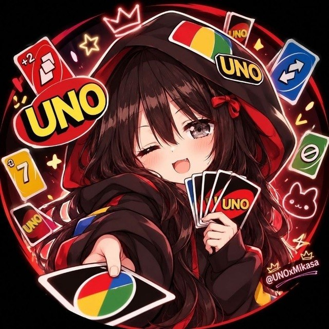

<div align="center">



</div>

<div align="center">


#### 𝕸𝖎𝖐𝖆𝖘𝖆 𝖀𝖓𝖔


[](https://t.me/Ig_MikasaBot)
[](https://t.me/Ig_MikasaBot?startgroup=true)


</div>

---

## 🃏 About

Mikasa UNO is a Telegram bot that lets you play UNO in group chats. Games run through inline mode, so anyone in the group can join a table and play their cards without leaving the chat.

All messages are shown in ꜱᴍᴀʟʟ ᴄᴀᴘꜱ by default (switch off with `SMALL_CAPS=false`).

## ✨ Features

- **Plays in group chats.** Add the bot to a group and start a table.
- **Inline play.** Type `@Ig_MikasaBot` to pick your cards from the chat.
- **Three game modes.** `classic`, `fast` and `wild`, set with `DEFAULT_GAMEMODE` and explained by `/modes`.
- **Stats.** `/stats` keeps your record in SQLite.
- **Admin control.** Set `ADMIN_LIST` to let specific users manage every game.
- **Built to stay awake.** The bot pings its own URL so free Render instances keep running.

## 🚀 Setup with @BotFather

1. `/newbot` and copy the **token**.
2. `/setinline` and choose a placeholder, for example `Pick a card`.
3. `/setinlinefeedback` and choose **Enabled** (100%).

Steps 2 and 3 are required because the game is played through inline mode. The command menu is set automatically by the bot.

## ☁️ Deploy on Render

Upload these files to a GitHub repository (`render.yaml` must be in the root).

**Option A: one click (Blueprint)**

Render dashboard → **New** → **Blueprint** → pick your repo → paste your `TOKEN` → **Apply**.

**Option B: manual Web Service**

| Setting | Value |
| --- | --- |
| Runtime | `Python 3` |
| Build Command | `pip install -r requirements.txt` |
| Start Command | `python bot.py` |
| Instance Type | `Free` |

Add these environment variables:

| Key | Value |
| --- | --- |
| `TOKEN` | your bot token |
| `PYTHON_VERSION` | `3.13.14` |

> `PYTHON_VERSION` should be `3.13.14`. The bot uses python-telegram-bot 22, which supports current Python releases. The repo also has a `.python-version` file as a second safeguard.

When the logs show `Command menu set`, open **[@Ig_MikasaBot](https://t.me/Ig_MikasaBot)** and send `/start`.

### Free plan notes

- Render sleeps free web services after 15 minutes without traffic. The bot pings its own URL every 10 minutes. For extra safety, add a free [UptimeRobot](https://uptimerobot.com) monitor for `https://YOUR-SERVICE.onrender.com/health` every 5 minutes.
- The free filesystem resets on every redeploy, so `/stats` data (stored in SQLite) resets too. Games live in memory anyway.

## ⚙️ Settings

| Variable | Default | What it does |
| --- | --- | --- |
| `TOKEN` | required | Bot token from @BotFather |
| `ADMIN_LIST` | none | Telegram user IDs (spaces or commas) who can manage every game |
| `SMALL_CAPS` | `true` | ꜱᴍᴀʟʟ ᴄᴀᴘꜱ text on or off |
| `DEFAULT_GAMEMODE` | `fast` | `classic`, `fast` or `wild` |
| `WAITING_TIME` | `120` | Seconds a player has per turn |
| `MIN_PLAYERS` | `2` | Players needed to start |
| `OPEN_LOBBY` | `true` | Whether new players can join a running game |
| `KEEPALIVE_URL` | Render's URL | Override the URL used for the keep-alive ping |
| `KEEPALIVE_INTERVAL` | `600` | Seconds between keep-alive pings |
| `DEV_CONTACT_URL` | `https://t.me/Sexiest_Banda` | Link behind the Dev button in `/about` |
| `EPHEMERAL_ENABLED` | `true` | Replies to listed commands are visible only to the person who sent them (groups only, Bot API 10.2+) |
| `EPHEMERAL_COMMANDS` | `help,modes` | Comma-separated commands that use ephemeral replies. Those commands are also marked ephemeral in the command menu, so the command message is private too |

`config.json` (see `config.json.example`) still works for local runs.

## 👻 Ephemeral replies

In groups, the commands in `EPHEMERAL_COMMANDS` send a command message only you and the bot can see, and the reply is only visible to you. This uses Telegram's ephemeral messages (Bot API 10.2, July 2026). `/stats`, `/about` and `/ping` stay public. `/help` is ephemeral, so its guide buttons have to edit an ephemeral message, which needs Telegram's `editEphemeralMessageText` call. That call is not wired up yet, so check the guide buttons in a group before relying on it.

## 🧪 Run locally

```bash
python3.13 -m venv venv && source venv/bin/activate
pip install -r requirements.txt
TOKEN=123:abc python bot.py
```

---

<div align="center">

*Shuffle up and deal.*

</div>
